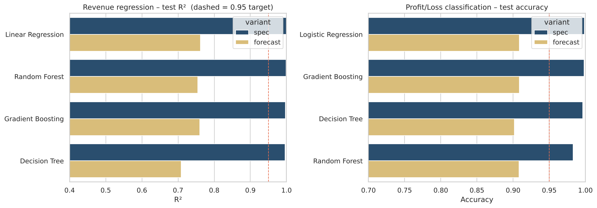
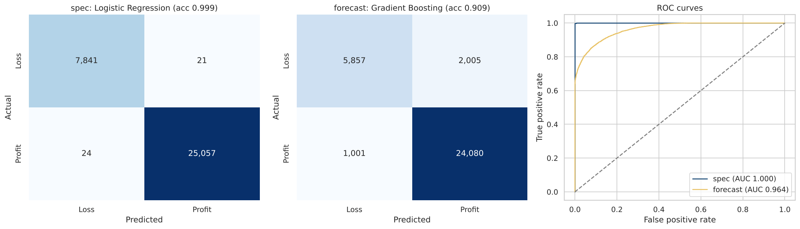
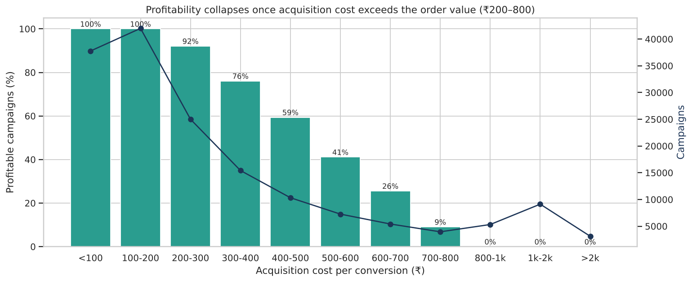
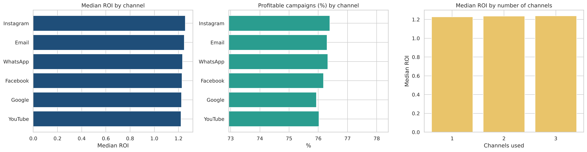

# 📈 Multi-Brand Marketing Campaign Performance Analysis & Prediction

An end-to-end **data analytics and machine learning** pipeline for the campaign data of three beauty brands: **Nykaa, Purplle and Tira**.
1. Three raw CSVs are loaded into one **pandas** DataFrame and cleaned. Missing values are handled, ROI is validated and missing values are recovered from it.
2. Features are engineered: **multi-label encoding** of marketing channels and a **Profit/Loss flag**.
3. The data is explored in a **Jupyter EDA notebook** (Matplotlib, Seaborn).
4. Revenue is predicted with **regression** and campaign Profit/Loss with **classification** (scikit-learn).
5. Everything is served in an interactive **Streamlit + Plotly** app.

**Domain:** Marketing Analytics & Business Intelligence

```
 3 CSVs (raw)  ──►  cleaning  ──►  feature engineering  ──►  EDA  ──►  regression + classification  ──►  Streamlit app
 166,665 rows       164,712 rows   multi-hot channels,       13 charts  Revenue (R² 1.000)               predict · dashboard ·
 ~5% nulls/col      ROI-validated  Profit_Flag, ratios                  Profit/Loss (acc 99.86%)         batch · insights
```

---

## Contents
1. [Key results](#key-results)
2. [Project structure](#project-structure)
3. [Setup & run](#setup--run)
4. [Data cleaning & preprocessing](#data-cleaning--preprocessing)
5. [Feature engineering](#feature-engineering)
6. [Models](#models)
7. [Streamlit app](#streamlit-app)
8. [EDA & insights](#eda--insights)
9. [Design decisions](#design-decisions)

---

## Key results

| | |
|---|---|
| Campaigns analysed | **164,712** across Nykaa, Purplle, Tira (Jul 2024 – Jun 2025) |
| Revenue / spend | **₹8,464.5 Cr** revenue on **₹2,878.9 Cr** spend, portfolio ROI **1.94** |
| Profitable campaigns | **76.1%** (125,401 profit · 39,311 loss) |
| #1 profitability driver | **Acquisition cost per conversion:** 100% profitable below ₹200, ~0% above ₹800 |
| Revenue regression | **R² = 1.000** (target ≥ 0.95), RMSE ₹6, Linear Regression on log-features |
| Profit/Loss classification (ROI excluded) | **Accuracy = 99.86%** (target ≥ 0.95), F1 0.999, Logistic Regression |
| Stricter pre-launch forecast (no ROI, no Revenue) | R² 0.762 · accuracy 90.9%, within 0.2 pts of the theoretical best of 91.1% |

| Task | Model | Spec test score | Forecast test score |
|---|---|---|---|
| Revenue | Linear Regression | **R² 1.0000** | R² 0.7621 |
| Revenue | Random Forest | R² 0.9988 | R² 0.7546 |
| Revenue | Gradient Boosting | R² 0.9966 | R² 0.7596 |
| Revenue | Decision Tree | R² 0.9958 | R² 0.7085 |
| Profit/Loss | Logistic Regression | **Acc 0.9986** | Acc 0.9087 |
| Profit/Loss | Gradient Boosting | Acc 0.9981 | **Acc 0.9088** |
| Profit/Loss | Decision Tree | Acc 0.9962 | Acc 0.9015 |
| Profit/Loss | Random Forest | Acc 0.9815 | Acc 0.9089 |

The full analysis is in the [EDA Report](reports/EDA_Report.md) and the [Model Evaluation Report](reports/Model_Evaluation_Report.md).

## Project structure

```
marketing-campaign-performance/
├── data/
│   ├── raw/                                   # Original brand CSVs (unchanged)
│   │   ├── nykaa_campaign_data_with_nulls.csv
│   │   ├── purplle_campaign_data_with_nulls.csv
│   │   └── tira_campaign_data_with_nulls.csv
│   └── processed/
│       ├── campaigns_clean.csv.gz             # Cleaned & missing values handled (164,712 rows)
│       ├── campaigns_features.csv.gz          # + multi-hot channels, Profit_Flag, ratios
│       └── cleaning_report.json               # What was fixed / recovered / dropped, with counts
├── notebooks/
│   └── 01_cleaning_eda_and_modeling.ipynb     # Full walkthrough (executed, with outputs)
├── reports/
│   ├── EDA_Report.md                          # Cleaning, EDA findings, insights, recommendations
│   ├── Model_Evaluation_Report.md             # Metrics, comparison, leakage checks, error analysis
│   ├── figures/                               # 14 charts
│   ├── model_comparison.csv                   # CV + test metrics, all models, both feature sets
│   ├── metrics.json                           # Best models, params, confusion matrices, importances
│   └── eda_summary.json                       # EDA numbers used in the reports
├── models/                                    # 4 saved scikit-learn pipelines (.joblib)
├── src/
│   ├── config.py                              # Paths, feature sets, settings
│   ├── cleaning.py                            # CSV → DataFrame, cleaning, ROI validation, imputation
│   ├── features.py                            # Multi-label encoding, Profit_Flag, ratios
│   ├── eda.py                                 # EDA statistics + figures
│   ├── train.py                               # Regression & classification, CV, tuning, evaluation
│   ├── transforms.py                          # log transforms used inside the pipelines
│   └── predict.py                             # Score a campaign / a CSV with the saved models
├── scripts/build_notebook.py                  # Rebuilds and executes the notebook
├── .streamlit/config.toml                     # App theme
├── app.py                                     # Streamlit app (6 pages)
├── run_pipeline.py                            # One command: clean → features → EDA → models
└── requirements.txt
```

## Setup & run

```bash
# 1. Clone and install (Python 3.10+)
git clone https://github.com/nivethakadiravan/marketing-campaign-performance.git
cd marketing-campaign-performance
python3 -m venv venv
source venv/bin/activate
pip install -r requirements.txt

# 2. Launch the app (trained models and processed data are already in the repo)
streamlit run app.py

# 3. (Optional) Re-run everything from the raw CSVs (~6 minutes)
python run_pipeline.py

# 4. (Optional) Open the notebook
jupyter notebook notebooks/01_cleaning_eda_and_modeling.ipynb
```

## Data cleaning & preprocessing

| Issue found | Action taken |
|---|---|
| ~5% missing in **every** column, and 54.7% of rows have at least one gap | Recover or impute rather than drop |
| 5,417 missing `Campaign_ID`s | Rebuilt exactly: IDs follow `<NY/PU/TI>-CMP-<1000 + row>` (100% match) |
| Duplicates | Checked: 0 duplicate rows or IDs |
| **ROI validation** | ROI = (Revenue − Cost × Conversions) / (Cost × Conversions). Checked on 136,312 rows, max difference 0.028 (rounding), 0 corrections needed |
| Missing ROI / Revenue / Acquisition_Cost / Conversions | **28,038 values recovered exactly** from the ROI identity |
| Revenue or ROI unrecoverable | 1,953 rows (1.2%) dropped, because targets are never imputed |
| Impressions / Clicks / Leads | Funnel-ratio imputation (brand-median CTR, lead and conversion rates), clipped, with funnel order kept |
| Engagement_Score | Linear fit on CTR (r = 0.96) |
| Duration | Brand median |
| Categorical gaps | `"Unknown"` category |
| Types | Date parsed (`dd-mm-yyyy`), counts cast to int, text stripped, channel lists normalised and sorted |

## Feature engineering

- **Multi-label encoding of `Channel_Used`**: `MultiLabelBinarizer` turns `"WhatsApp, Google, YouTube"` into six 0/1 columns `Ch_Email … Ch_YouTube`, plus `Num_Channels` and `Channel_Unknown`.
- **`Profit_Flag`** = 1 if ROI > 0 (Profit), else 0 (Loss).
- `Total_Spend` = Acquisition_Cost × Conversions; `CTR`, `Lead_Rate`, `Conversion_Rate`; `Month`, `Weekday`.
- Model-time transforms: `log1p` on skewed money and count columns, `log(1 + ROI)`, scaling, one-hot encoding for categories.

## Models

- **Split:** stratified 80/20 (131,769 / 32,943).
- **Selection and tuning:** 3-fold CV on the training data picks the algorithm. `RandomizedSearchCV` tunes it, and the tuned settings are kept only if they beat the defaults. The test set is used once.
- **Algorithms:** Linear/Logistic Regression, Decision Tree, Random Forest, Gradient Boosting.
- **No leakage:**
  - ROI is never a classification input; this is enforced with an `assert`.
  - All preprocessing sits inside the `Pipeline`.
  - A second, stricter **forecast** feature set drops ROI *and* Revenue, to show what can be predicted before revenue is known.

| Feature set | Revenue inputs | Profit/Loss inputs |
|---|---|---|
| **spec** (brief) | campaign + funnel + cost features **+ ROI** | same **+ Revenue**, **no ROI** |
| **forecast** | campaign + funnel + cost features | campaign + funnel + cost features |

The spec scores are near-perfect for a structural reason:
- Revenue = Spend × (1 + ROI), and Profit ⇔ Revenue > Spend, so the spec models are essentially reproducing an accounting identity.
- The forecast models come within 0.01 R² and 0.2 accuracy points of the theoretical limit. That limit exists because order value per conversion is spread evenly over ₹200–800 and recorded nowhere else.

<p align="center">
  
  
</p>

## Streamlit app

| Page | What it does |
|---|---|
| **Predict a campaign** | Enter brand, type, audience, **multi-select channels**, funnel numbers, cost (and ROI for the spec model). The same preprocessing is applied, and the page shows **predicted revenue**, spend, implied ROI, **Profit/Loss with a probability gauge**, the input funnel and a cost-band explanation. You can switch between spec and forecast models |
| **Performance dashboard** | Brand filter, KPIs, revenue vs spend, profit rate, ROI by campaign type and channel, profit by cost band, spend-vs-revenue and clicks-vs-revenue scatters, monthly trend, top/bottom 10 campaigns |
| **Batch prediction** | Upload a CSV and download predictions (a sample file is provided) |
| **Model performance** | All metrics for both tasks and feature sets, with charts |
| **Data cleaning** | Missing-value chart, the cleaning log, a multi-label encoding example |
| **Insights** | Findings and recommendations generated from the results |

## EDA & insights

<p align="center">
  
  
</p>

1. **Acquisition cost per conversion decides profitability.** Order value ranges ₹200–800, so every campaign under ₹200 per conversion was profitable. The profit rate falls to 41% at ₹500–600 and to ~0% above ₹800 (Spearman ρ between cost and ROI = −0.93).
2. **Engagement quality separates winners from losers.** Top-10% ROI campaigns have a median cost of ₹47 vs ₹1,208 in the bottom 10%, along with 11.7% vs 4.4% CTR and 3× the engagement.
3. **Brand, channel, campaign type, audience and language barely matter.** Median ROI differs by ≤ 0.06 across all of them, and using 1, 2 or 3 channels gives the same ROI. Paid Ads (1.27) and Instagram (1.26) are only marginally ahead.
4. **Spending more does not buy revenue.** Total spend and revenue are uncorrelated (r ≈ 0); efficiency is what matters.
5. **Recommendations:**
   - Cap cost per conversion at about ₹300 (92% profitable at ₹200–300) and stop campaigns above ₹800.
   - Invest in creative and targeting (CTR, engagement) rather than channel reshuffling.
   - Screen plans with the pre-launch forecast model.

## Design decisions

- **Recover before imputing:** the ROI identity recovers 28,038 missing values exactly, which is better than any statistical fill. Targets (Revenue, ROI) are never imputed.
- **"Unknown" for missing categories** instead of the mode, so no false information is invented, and the model can learn whether missingness matters.
- **Log scales** for revenue and money features. Revenue is right-skewed, and on log scales the Revenue–Spend–ROI relationship becomes additive, which lets the linear models capture it exactly.
- **Two feature sets:** the spec set meets the brief and its ≥ 0.95 targets, and the forecast set gives an honest measure of predictive power for planning.
- **Simple models win:** Linear and Logistic Regression beat the tree ensembles on the spec task, and all four algorithms reach the same ceiling on the forecast task.
- **Gzipped processed data** keeps the repo small, and pandas reads `.csv.gz` directly.
